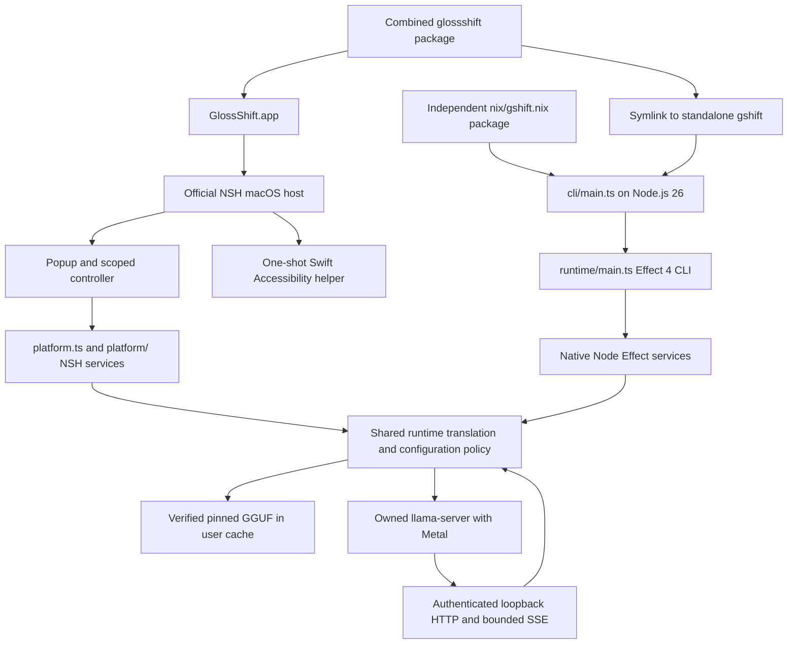

# Runtime architecture

This explanation is for contributors who maintain platform services, entry points, or Nix packaging.
GlossShift has two separate execution environments that share translation policy, not a JavaScript host.

## Process and package ownership

The desktop runs TypeScript in the unmodified official NSH 0.5.0 macOS host.
Selection capture uses a separate one-shot Swift executable.
The desktop does not start Node or register a custom Rust module.
The noninteractive `gshift` command runs `cli/main.ts` on Node.js 26 with native Effect services.
Its declarative Effect 4 CLI definition lives in `runtime/main.ts`.
No arguments show help, and `--tui` is rejected.
The desktop application launches separately.

`nix/gshift.nix` includes the native entry, runtime modules, production JavaScript dependencies, Node.js 26, and required inference and file utilities.
Its closure excludes NSH and Swift.
The combined `glossshift` package contains the GUI and links the standalone CLI, so that combined closure includes Node.
A Node-free GUI process is not a Node-free combined package closure.

The inference server starts lazily after a translation request.
Help and version requests do not load configuration or model weights.
Each launch owns its server rather than connecting to a shared daemon.
Concurrent desktop and CLI launches can load separate model instances and consume additional memory.
Both entries use the real Effect AI `LanguageModel` adapter, configuration, prompt policy, and token-budget calculation.
There is no translation sidecar or JSON acknowledgment protocol between policy and its host.

## Effect Platform boundary

The extraction-ready `platform.ts` and `platform/` library supplies Effect services through NSH APIs without GlossShift-specific environment policy.
Its public composition accepts working directories, tool paths, configuration providers, and standard I/O explicitly.
`runtime/platform.ts` supplies the GUI's application environment.
The native CLI uses Node-backed services instead of importing the NSH library.
Named modules sit beside their child directories, with no `index.ts` modules.
See [NSH Effect Platform](../platform/README.md) for supported services and explicit unsupported operations.

NSH Promise APIs remain in boundary adapters and are lifted into scoped Effects.
The GUI controller interrupts an active translation on cancellation or replacement.
Bounded provider deltas remain lossless, while complete view snapshots may coalesce.
Cancellation does not wait behind a full delta queue.
The translation scope releases its HTTP request and child processes independently of consumer progress.

NSH 0.5.0 provides a subset of Node-compatible modules, not a complete Node process environment.
Compatibility evidence concerns the pinned official host, not generated types alone.
Upstream implementations include [filesystem operations](https://github.com/longbridge/nsh/blob/f4d68f7f9f31eb7b3ecc8a4cbc31096d5c6238a1/crates/nsh-core/src/runtime/fs.rs) and [process operations](https://github.com/longbridge/nsh/blob/f4d68f7f9f31eb7b3ecc8a4cbc31096d5c6238a1/crates/nsh-core/src/runtime/process.rs).

| Capability               | NSH compatibility boundary                                                                                                 |
| ------------------------ | -------------------------------------------------------------------------------------------------------------------------- |
| SHA-256 and random bytes | Compatible crypto operations supply small authentication values.                                                           |
| HTTP and SSE             | Fetch body streams support incremental decoding and cancellation for direct authenticated loopback requests.               |
| Filesystem               | Whole-file reads are limited to 64 MiB and writes to 8 MiB. Streaming handles and secure exclusive creation are absent.    |
| Child processes          | Explicit executable and environment grants constrain the scoped event-based subprocess adapter.                            |
| Parent CLI handles       | Native parent arguments, working directory, and standard streams are absent. The standalone CLI uses Node instead.         |
| Browser XML parser       | QuickJS lacks the `DOMParser` expected by the plist browser entry. A narrow dependency patch uses its declared XML parser. |

The NSH adapters use fixed packaged curl and coreutils commands for bounded model I/O and narrow atomic file operations.
A complete GGUF never enters the JavaScript heap.
Installed manifests and launchers use matching immutable executable paths.
Absolute paths do not grant access outside NSH's permitted filesystem roots.
External utilities do not automatically inherit NSH filesystem enforcement, so their adapters preserve private temporary directories, atomic publication, and source-file safety.
Unsupported Platform operations fail explicitly.
NSH controls child environments through manifest grants rather than per-spawn overrides.
Its process adapter rejects unsupported environment overrides, descriptor redirection, and pipelines.

## Native CLI boundary

The CLI receives arguments, standard streams, signals, exit status, and the working directory through Node's native process environment.
The former shell capture bridge, `gshift-launcher.sh`, Nix batch launcher, and `batch/` and `terminal/` products are not part of this architecture.
There is no headless NSH process or wrapper-owned output directory.

Relative input paths resolve through the injected Path service.
The command validates every sibling output and rejects input/output collisions before loading configuration or a model.
It preserves input order, normalized language suffixes, and safe forced replacement of symbolic links without changing their targets.
Plain stdout contains translations without inserted separators or host diagnostics.
Color styles a complete translation without parsing Markdown or adding syntax highlighting.
An unfinished translation is not published as a completed file, although earlier completed inputs can remain after a later failure.
Diagnostics go to stderr, and failures return a nonzero native exit status.

## Accessibility and GUI lifecycle

The desktop registers shortcuts through standard NSH APIs.
It requests text from `glossshift-macos-helper --selection` before revealing or activating the popup.
The helper uses Apple's ApplicationServices framework, emits one bounded JSON response, and exits.
Its `--permission` command checks permission without prompting or reading a selection.
The injected launcher and response decoder can be replaced for another operating system without changing translation policy.

The helper does not own a GUI loop, register shortcuts, simulate copy keystrokes, or modify the clipboard.
An application without `AXSelectedText` produces a stable public failure rather than a simulated copy fallback.
The CLI never starts this helper.
Nix compiles it separately from the TypeScript bundle.
NSH retains its AppKit event loop and delegate.
Closing the popup hides it and retains state, while background startup must not briefly activate a window.
Connection-scoped child processes and shortcuts are released without letting an old scope unregister a newer scope's resources.

## Local inference and model storage

The server comes from the unmodified Nixpkgs unstable `llama-cpp` 0.9.0 package at revision `d4f25a3e562008648d45bcf2d70bcc7422cad84e`.
The macOS arm64 derivation has a signed substitute in `cache.nixos.org` and includes Metal support.
The inference pin is separate from the main toolchain pin.
There is no direct llama FFI, custom engine build, or native Node addon.
The server binds only to `127.0.0.1` on a kernel-selected port.
A fresh authentication key lives in a private temporary file rather than command-line arguments.
Server diagnostics stay out of translation stdout and public failures.

The default first translation downloads the pinned official PLaMo 3 Translate 0.8B GGUF into the user's cache.
Downloads resume when byte ranges are supported and require full SHA-256 verification before atomic publication.
A verified offline cache hit does not contact Hugging Face.
Model endpoints supply weights only, and source text stays on the Mac.
Built-in 0.8B, 2B, 8B, and 31B presets select immutable single-file Q4_K_M artifacts without a settings file.
Their context policy uses the full 262144-token maximum declared by all four presets, not an artificial 8192-token default or 32768-token global cap.
The publisher's `max_position_embeddings` metadata declares that maximum for [0.8B](https://huggingface.co/pfnet/plamo-3-translate-0.8b/blob/main/config.json), [2B](https://huggingface.co/pfnet/plamo-3-translate-2b/blob/main/config.json), [8B](https://huggingface.co/pfnet/plamo-3-translate-8b/blob/main/config.json), and [31B](https://huggingface.co/pfnet/plamo-3-translate-31b/blob/main/config.json).
The 32768-token translation-training length is not the architecture's positional ceiling.
After trusted prompt tokenization, the completion budget is `min(maxTokens, contextSize - promptTokens)`.
An explicit output limit can reduce that budget.
There is no fixed 4096-token output default.
Unknown custom GGUF digests require an explicit `contextSize` instead of inheriting the default PLaMo budget.
Known preset artifacts are recognized by digest and retain their full model default even when selected through a custom `file:` URI.
Context allocation consumes memory beyond the GGUF file size and can require a smaller explicit context on a memory-constrained Mac.
PFML special tokens and untrusted source are tokenized separately, with BOS added once and protocol stop tokens suppressed.
Unsupported languages, context overflow, and incomplete output fail rather than publishing successful partial files.

Real source and installed standalone CLI checks successfully translate cached 0.8B input with the configured 262144-token context, without model downloads.
They cover Japanese and English output, clean stdout, safe forced symbolic-link replacement, and SIGTERM cleanup of the owned server and authentication file.
A separate diagnostic check uses the same production server startup with `-c 262144` and verifies Metal plus positive GPU layer offload.
These results establish full-context configuration and startup with real short-input inference, not a 262144-token prompt, comparative performance, or larger-model acceptance.
Larger model weights have not been downloaded or run for these changes.
The GUI bundle's signature and package boundaries are checked separately.
Accessibility permission is not granted in the verification environment, so actual selection capture, visible GUI behavior, and global shortcut interaction remain unverified.
See [cached-model acceptance instructions](../AGENTS.md#reproduce-cached-model-acceptance) to reproduce the source and installed CLI checks with isolated settings and existing weights.
See [Dependency compatibility](./dependency-compatibility.md) for exact pins and retained patches.

## Build and verification boundaries

- Vite+ owns dependency installation, tasks, formatting, lint, and native CLI tests through Vitest.
- Official NSH commands check, run, test, bundle, and package the GUI.
- Native CLI tests use reusable `.test` helpers and isolated filesystem settings, without a copied NSH harness.
- Swift helper contract tests run separately with synthetic input and never read another application's selection.
- Nix uses official NSH binaries and the pinned llama-cpp substitute, builds the small Swift helper separately, and packages the standalone Node CLI independently.
- Distribution source inputs exclude all tests, test-only helpers, and fixtures. Package derivations run no tests or checks.
- Model weights remain outside the Nix store and are not fetched during a build.
- Installed CLI inference, GUI behavior, and package closure inspection are separate checks. A successful bundle alone proves none of them.

Nix generates a small signable Mach-O GUI entry point that runs the audited launch script and replaces itself with the official NSH host.
The script lives under Resources to preserve the macOS bundle resource seal.
Ruby, standalone test scripts, and hand-maintained JavaScript test bundles are not part of the toolchain.
